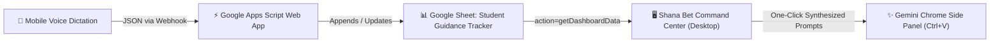

# Shana Bet Guidance Command Center

A modern, responsive desktop web application engineered for a yeshiva guidance counselor and mashgiach overseeing 69 Shana Bet (second-year post-high school) students and visiting alumni.

Built with **Vite**, **Tailwind CSS v4**, and **vanilla ES modules**, the interface is optimized for widescreen desktop monitors while leaving comfortable space on the right for the **400px Google Chrome Gemini Side Panel**.

---

## 🏛️ Architectural Context & Data Flow



1. **Primary Data Input:** The mashgiach/counselor records quick voice dictations on mobile after meetings or shabbatot. The input sends JSON to the Google Apps Script Web App which maintains the Google Sheet (*Student Guidance Tracker*).
2. **Desktop Command Center:** Acts as the executive triage and guidance hub:
   - Evaluates meeting intervals and flags overdue students.
   - Surfaces unaddressed agenda items and long-term pinned context.
   - Tracks cohort-level (*Klal*) educational and programming initiatives.
   - Monitors Shabbat hospitality reach (0 meals, 1 meal, 2+ meals).
3. **Gemini Chrome Side Panel Synergy:** Generates tailored, rich structured prompts copied directly to the clipboard. The counselor pastes them into the 400px Chrome side panel (`Ctrl+V`) for instant meeting preparation briefings and executive updates.

---

## ✨ Features & Layout

### 1. Header Bar & Triage Statistics
- **Real-Time Quick Stats:**
  - Total Cohort Size (`69` students)
  - Met This Week (past 7 days)
  - Overdue (`> 21 days` or never met)
  - Agendas Waiting (`NextAgenda` non-empty)
  - Active Klal Initiatives
- **Instant Search:** Press `/` to focus the search bar. Instantly filters students by name, ID, next agenda content, or notes.
- **Resilient Sync & Local Caching:**
  - Loads instantly from `localStorage` cache or built-in offline data.
  - Automatically syncs in the background with the live Google Apps Script endpoint.
  - Graceful fallback with informative status badges if network is slow or offline.
  - Manual **"Refresh Data"** button with spinning indicator.

### 2. Column 1: Attention Radar (Triage Column - Left)
- **Urgency Grouping:**
  - 🔴 **Critical:** `> 30 days` without a meeting or never met.
  - 🟡 **Attention:** `21 – 30 days` since last meeting.
  - 🟢 **Recent:** `< 21 days` since last meeting.
- **Filter Tabs:** All (`69`), 🔴 Critical, 🟡 Attention, 🟢 Recent, and 💡 Pending Agenda.
- **Sort Options:** Most Overdue First, Pending Agendas First, Student Name (A-Z), Student ID (S01-S69), or Shabbat Meals (Lowest First).
- **Indicator Badges:** Highlight students with unaddressed agenda items (`💡 Agenda`), Shabbat meal count (`🍷 0` or `🍷 1`), and pinned guidance goals (`📌`).

### 3. Column 2: Interactive Student Dossier (Center)
- **Profile Header:** Name, ID (`S01`, `S13`, etc.), Shiur/Cohort, last met date, total Shabbat meals.
- **⚡ Direct Desktop Edit: "Mark Met Today":** Instantly marks the student as met today, updates `LastMetDate` in the Google Sheet via Apps Script, shifts the student to 🟢 Recent in the Attention Radar, and recalculates cohort stats optimistically.
- **Pinned Guidance Focus Box:** Indigo callout highlighting the student's long-term developmental focus, spiritual trajectory, or character goals.
- **Pending Agenda Box & Direct Edit Actions:**
  - High-priority amber callout displaying unaddressed ideas or follow-ups waiting for the next session.
  - **✓ Direct Desktop Edit: "Clear Agenda":** One-click button next to the agenda header to clear the pending agenda items on both the screen and the Google Sheet (`clearAgenda`).
  - **+ Direct Desktop Edit: Quick Inline Agenda Adder:** Inline input form (`[ e.g. Discuss chavrusa pacing... ] [+ Add]`) allowing you to type and instantly append new agenda bullets directly to the Sheet (`addIdea`).
- **Chronological History Timeline:** Visual timeline of past meetings, interaction types (Meeting, Check-in), detailed discussion summaries, and agreed next steps.
- **Gemini Copilot Tools (One-Click Prompt Exporters):**
  - 📋 **Prep Meeting Briefing:** Synthesizes the student's background, days elapsed, pinned goals, pending agenda, and past logs into a prompt instructing Gemini to supply a 2-minute briefing, 3 conversational openers, and guidance tools.
  - 📝 **Draft Parent / Rosh Yeshiva Update:** Synthesizes the student's trajectory into two distinct drafts (an internal candid Hanhala update and a warm, reassuring parent note).
  - 🍷 **Invite Check:** Generates a warm, low-pressure Shabbat invitation message tailored to the student.
  - 👁️ **Prompt Preview:** Inspect, edit, or copy prompts inside a monospace preview dialog.

### 4. Column 3: Klal Initiatives & Hospitality Matrix (Right)
- **Klal Macro Board:**
  - Status filters (`Active`, `Backlog`, `Completed`) and Domain filters (`Educational` vs `Programming`).
  - **⚡ Interactive Status Dropdown:** Directly switch any initiative's status (`Active` | `Backlog` | `Completed`) right from its card, automatically updating the Google Sheet (`updateKlalStatus`) with optimistic local updates.
  - Cards displaying Target Timing (e.g. *Winter Zman*, *Meah Shearim Shabbaton*), Core Vision, and Action Plans.
  - 📊 **Generate Cohort Report:** Synthesizes macro cohort metrics and active initiatives for an executive Hanhala briefing.
- **Shabbat Hospitality Matrix:**
  - Visual distribution meter (`0 meals`, `1 meal`, `2+ meals`).
  - Priority queue of candidates who have not yet had a Shabbat meal, with 1-click invite prompt generation.

---

## ⚡ Direct Desktop Edits & CORS Architecture

All direct desktop micro-updates (`markMetToday`, `clearAgenda`, `addIdea`, `updateKlalStatus`) communicate directly with the Google Apps Script Web App:
- **No CORS Preflight Failures:** Requests are dispatched via `POST` with `Content-Type: text/plain;charset=utf-8`. Because this qualifies as a simple CORS request, the browser bypasses the `OPTIONS` preflight step that Google Apps Script typically rejects.
- **Optimistic UI:** Every button press immediately updates the UI, local state, and `localStorage` cache. A subtle status toast informs the counselor ("Saving to Sheet..."), and changes are automatically rolled back with an alert banner if network transmission fails.
- Complete backend Google Apps Script code is provided in [`APPS_SCRIPT.md`](APPS_SCRIPT.md).

---

## 🚀 Getting Started Locally

### Prerequisites
- [Node.js](https://nodejs.org/) v18+ or v20+ installed.

### Installation & Development
```bash
# 1. Install dependencies
npm install

# 2. Run local development server
npm run dev
```

Vite will start a local server (typically at `http://localhost:5173/`). Open this URL in Google Chrome.

### Building for Production
```bash
npm run build
```
The optimized bundle will be generated in `./dist/`. You can preview the production build locally with:
```bash
npm run preview
```

---

## 🌐 Deploying to GitHub Pages

### Method 1: Automatic Deployment via GitHub Actions (Recommended)
This repository includes a pre-configured workflow at [`.github/workflows/deploy.yml`](.github/workflows/deploy.yml).

1. Push your code to GitHub:
   ```bash
   git add .
   git commit -m "Initial commit of Shana Bet Guidance Command Center"
   git branch -M main
   git remote add origin https://github.com/<your-username>/<your-repo-name>.git
   git push -u origin main
   ```
2. In your GitHub repository:
   - Go to **Settings** → **Pages**.
   - Under **Build and deployment** → **Source**, select **GitHub Actions**.
3. Every push to `main` will automatically build and deploy the dashboard to `https://<your-username>.github.io/<your-repo-name>/`.

### Method 2: Manual Deploy using `gh-pages`
If you prefer deploying directly from your local terminal:
```bash
npm install -D gh-pages
```
Add to `package.json` scripts:
```json
"deploy": "vite build && gh-pages -d dist"
```
Then run:
```bash
npm run deploy
```

---

## ⚙️ Configuration & Backend Endpoint

The application communicates with Google Apps Script via:
- **Endpoint:** `https://script.google.com/macros/s/AKfycbyPqoLKl-sbwQmewRex_5u8ihj4DBzE-uKHGma_valOC2OdUdZHVD7e3JYBGXkdxjX4Iw/exec`
- **Query Parameter:** `?action=getDashboardData`
- To change or point to a staging spreadsheet endpoint, update `GAS_ENDPOINT` in [`src/data-service.js`](src/data-service.js).

